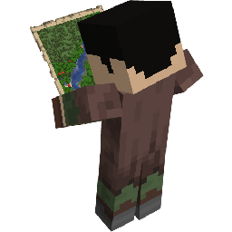

<p align="center">
  
</p>

# Recruits RTS Command

Recruits RTS Command adds group selection and map orders to the tactical map in [Villager Recruits](https://modrinth.com/mod/villager-recruits).

## Features

- Select individual recruits, whole squads or saved control groups.
- Issue move, queued move, halt, facing and attack orders from the map.
- Set formations, spacing, combat behaviour, shield state and fire zones.
- Display squad positions, routes, health and compatible map objects.
- Show oriented tactical unit symbols when zoomed out: crossed lines for infantry,
  a bow for ranged troops, a diagonal for cavalry and a cross for mixed units.
  Own troops are green, allies blue, neutral troops ochre and enemies red. Unit
  dots use the same relation colors. Individual picking temporarily restores dots.
- Keep the tactical map available when the server does not have RTS Command; command controls remain disabled.

## Dependency

- [Villager Recruits 1.15.2+](https://modrinth.com/mod/villager-recruits)

Minecraft 1.20.1 and Forge 47 are supported.

## Compatibility

[Siegeworks](https://github.com/mess1re/siegeworks) supports issuing orders to siege equipment from the tactical map.

See the [wiki](https://github.com/mess1re/recruitsrtscommand/wiki) for controls, orders and server configuration.

Map updates are accepted at most once every five server ticks per player. A move
route holds up to 128 waypoints; further queued points are ignored until space is
available. Fire-zone radii are limited to 48 blocks on both the client and server.

Both sides need the same RTS Command protocol version for command controls.
The update includes unit headings and order states in map snapshots (protocol 4) and requires
updating the mod on both the server and clients.

Queued moves advance after at least 80% of the troops reach a waypoint. The
arrival radius defaults to 5 blocks, with a minimum of 4 to match Recruits'
movement tolerance. Orders retry three times without progress and halt after
45 seconds without approaching the destination. A blocked route stays visible
in red for 20 seconds; selection status and squad tooltips explain the result.
Pursuit stops when current scouting visibility no longer reveals its target.

## API

Release builds are available through JitPack:

```gradle
repositories {
    maven { url 'https://jitpack.io' }
}

dependencies {
    implementation fg.deobf('com.github.mess1re:recruitsrtscommand:0.1.0-beta.1')
}
```

## License

Recruits RTS Command is licensed under [LGPL-3.0-only](LICENSE).
